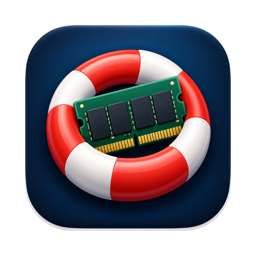
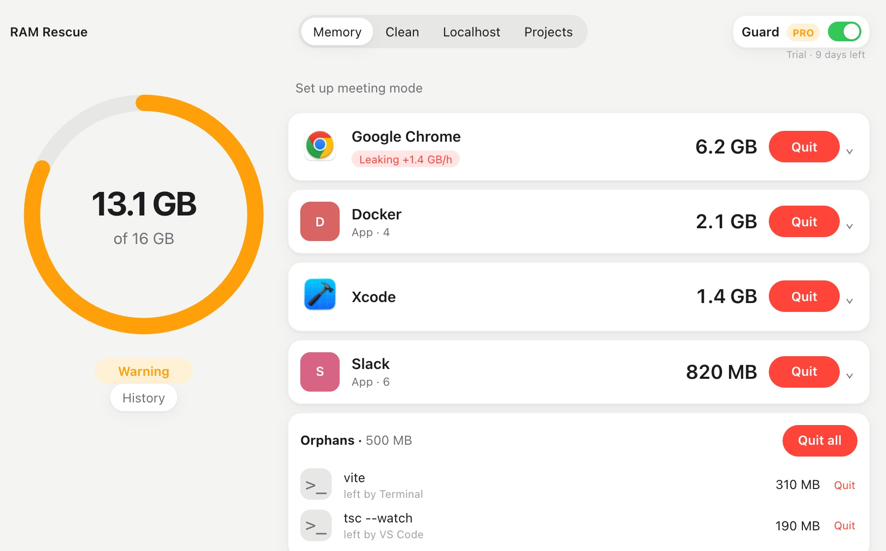
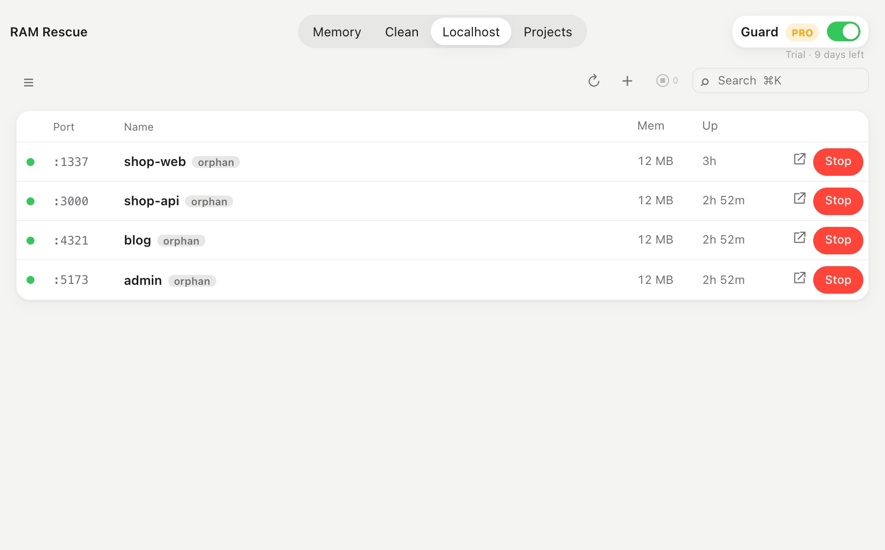
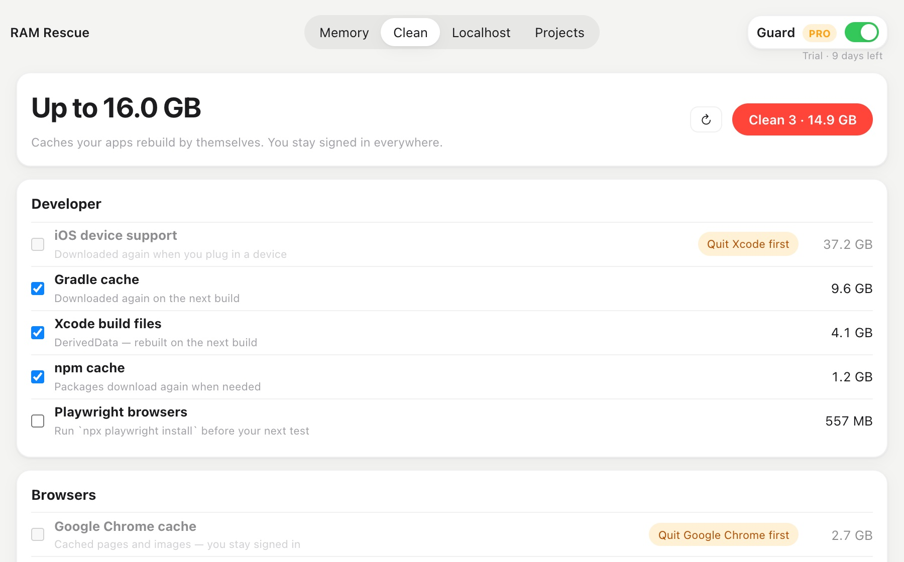
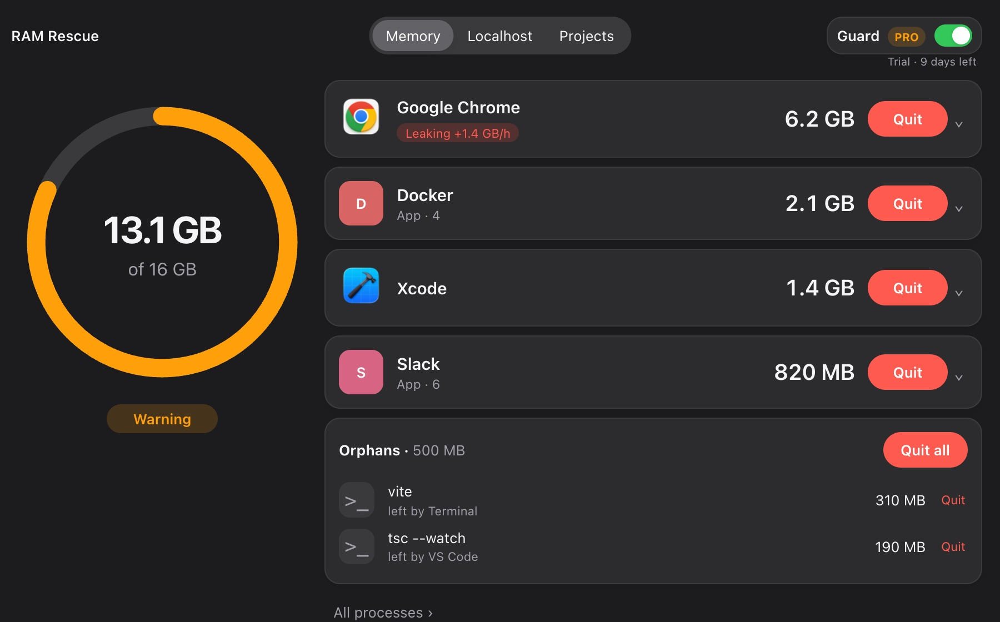
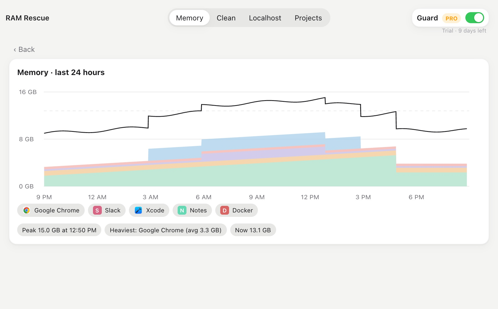
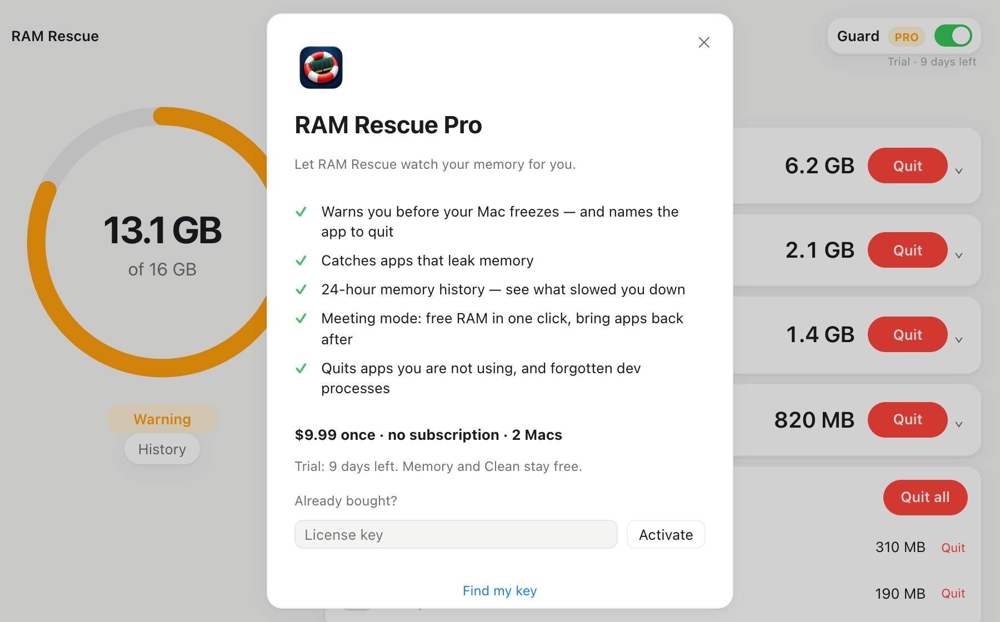

<p align="center"></p>

<h1 align="center">RAM Rescue</h1>

<p align="center"><b>Find what is eating your Mac's memory — and quit it in one click.</b><br>
Plus every localhost server and whether it works. Free and open source (MIT) for macOS · Apple silicon & Intel ·
signed & notarized by Apple · no account · nothing leaves your Mac · optional <a href="#pro--guard">Pro</a> ($9.99 once)</p>

<p align="center">
  <a href="https://github.com/nvminhtu/ram-rescue/releases/latest/download/RAM-Rescue-mac.dmg"><b>⬇ Download for Mac</b></a> ·
  <a href="#install">Install</a> ·
  <a href="#faq">FAQ</a> ·
  <a href="https://github.com/nvminhtu/ram-rescue/releases">Releases</a>
</p>

Mac slow, fans loud, "memory pressure" in the yellow? RAM Rescue opens on the **Memory** tab: a big ring shows how much
RAM is in use, and the apps using the most are cards with their own icon (Chrome with its 45 helpers counted as one app),
each with a large **Quit** button. Dev processes left behind by a closed terminal, editor or AI agent — **orphans** — get their own list and a
**Quit all**. The **Localhost** and **Projects** tabs show every dev server on your Mac, whether it answers, and let you
start or stop it.

With **Pro**, RAM Rescue also watches for you from the menu bar: it warns you before your Mac slows down, catches apps
that leak memory, and can quit forgotten dev processes by itself.

<sub>Formerly **Server Hub** (until 0.3.0). Your settings carry over.</sub>



<sub>Screenshots use a sample stack (`shop-web`, `shop-api`, `cms`, `blog`, `admin`, `queue`) in `~/code` and `~/work`.</sub>

---

## Contents

- [Features](#features)
- [Pro — Guard](#pro--guard)
- [Download](#download)
- [Install](#install)
  - [Signed and notarized by Apple](#signed-and-notarized-by-apple)
- [Getting started](#getting-started)
- [Share on your local network](#share-on-your-local-network)
- [How it works](#how-it-works)
- [Keyboard shortcuts](#keyboard-shortcuts)
- [Privacy](#privacy)
- [FAQ](#faq)
- [Troubleshooting](#troubleshooting)
- [Uninstall](#uninstall)
- [Build from source](#build-from-source)
- [Feedback](#feedback)
- [License](#license)

## Features

### Localhost — what is running right now



Every TCP port on your Mac that a browser could open: dev servers, local APIs, databases. The list
refreshes every few seconds.

| Dot | Meaning |
|---|---|
| 🟢 **healthy** | answers HTTP with a status below 500; the response time is shown |
| 🔴 **unhealthy** | answers with HTTP 5xx, or the port is open but nothing answers |
| 🔵 **not a web page** | the port is alive but speaks another protocol (Postgres, Redis, adb…) |

Each row stays short: status dot, port, project name, **↗** open in the browser and **■** stop (click twice to confirm).
**Click a row** and a detail panel opens at the bottom with everything else:

- the URL, the health result and, when shared, the [LAN link](#share-on-your-local-network)
- the **project folder name** and the **tool** behind it: vite, next, astro, nuxt, webpack, http.server, uvicorn,
  django, rails, angular and others
- **uptime** and **memory**
- **who started it**: Terminal, iTerm, Warp, Ghostty, VS Code, Cursor, Xcode, Claude Code, Codex, or RAM Rescue itself
- the command, folder and PID
- buttons: **Open** · **Share on LAN** · **Show in Finder** · **Copy URL** · **Stop**

`Esc` or **✕** closes the panel.

RAM Rescue never stops macOS system processes.

### Projects — start and stop what you build

- **Only what runs, by default.** The list and the sidebar show running projects only, so a folder with 30 projects
  doesn't bury the 3 you are using. Tick **Show all** in the top bar to see every project, stopped ones included
  (RAM Rescue remembers the choice).
- **Add one or more project folders** (`~/code`, `~/work`, `~/Developer`…). RAM Rescue finds everything that can
  run inside them:
  - `package.json` with a `dev` or `start` script that starts a server (vite, next, astro, node, webpack…)
  - `.claude/launch.json` (the file Claude Code uses to start dev servers)
  - `run.sh`
- **▶ Start** runs the command in the right folder, using the same `PATH` as your terminal (Homebrew, nvm, fnm, volta…).
  **■ Stop** shuts down the whole process group, so npm, vite and esbuild all exit together.
- **Live log** for everything you start from RAM Rescue, in the detail panel next to the project's info: the last
  2,000 lines, with errors in red and "ready" lines in green.
- **Health in the list:** a project that is running but returns 5xx gets a red dot.
- **Port clash warning** when two projects want the same port, with the name of whoever holds it.
- **■ Stop all** asks first and lists every server it will stop.
- **+ Add** a server by hand (name, folder, command, port) for anything RAM Rescue can't detect.

### Memory — what eats RAM, and what was left behind

The first tab shows what uses your memory, so you can quit the heavy ones:

- **Ring** on the left: used of total (like Activity Monitor's *Memory Used*) and the macOS memory pressure
  (Normal / Warning / Critical).
- **Cards** for the heaviest apps (500 MB and up), with the app's icon, its memory and a big **Quit** (⌄ for Force Quit).
  **All processes ›** opens the full list below.
- **One row per app.** Chrome with 45 helper processes is one row, `Google Chrome · App · 45`, with their memory summed.
- **Filters:** **High** (500 MB and up) · **Medium** (150–499 MB) · **Low** · **Orphans** · **All**. **Hide system** is on by
  default; system rows are never quittable.
- **Quit** on the selected row asks first and says how much it frees. *Quit* asks the app to close normally (only its
  main process is signalled, so it shuts its helpers down itself); *Force Quit* kills every process of the app.
  Tick several rows to quit them in one go.
- **Orphans:** dev processes whose terminal, editor or agent is gone — a `vite` started by Claude Code, a Playwright
  Chromium after a test run, a `tsc --watch` from a closed VS Code. Their parent is now `launchd`, so nothing will ever stop
  them. The **Orphans** filter lists them with **Left by** (who started them, when RAM Rescue saw it) and **Quit all**;
  the Memory tab shows a red count while there are any. On the Localhost tab such a server gets a grey `orphan` tag.
  Apps from the Dock and `brew services` are never counted as orphans.

### Clean — caches apps rebuild by themselves



The **Clean** tab measures caches that apps rebuild on their own and moves the ones you tick to the **Trash**:
Xcode build files (DerivedData) and iOS device support, simulator caches, npm, Yarn, Gradle, CocoaPods, Homebrew,
pip, Playwright browsers, and the caches of Chrome, Edge, Brave, Arc, Firefox and Safari.

- Nothing is deleted: empty the Trash to get the space back, or drag a folder back out of it.
- A browser's cache can be cleaned only while that browser is closed (the row says *Quit Chrome first*).
- Safari's folder is protected by macOS: the row says *Needs Full Disk Access* until you allow it.
- Never cookies, history, passwords, Xcode Archives or your projects — you stay signed in everywhere.



### Menu bar

The menu bar shows the memory in use, e.g. `13.1 GB`, with `⚠︎` when memory pressure is high. Click it to see the
3 heaviest apps (**Quit Google Chrome — 6.2 GB**), every open port (click to open it in the browser) and stop a running
project. If you close the window, RAM Rescue keeps running in the menu bar. Quit it from the menu bar icon.

## Pro — Guard

Everything above is free and stays free. **Guard** is the Pro part: RAM Rescue keeps an eye on memory for you, from the
menu bar, even with the window closed. Switch it on or off with **Guard** at the top right; click the word for settings.

- **Warns before your Mac slows down.** When memory pressure stays yellow or red for 30 seconds, a notification names
  the app using the most memory, with a **Quit** button. Click the banner instead to open RAM Rescue on that app.
  The same app is not mentioned again for 30 minutes.
- **Catches apps that leak memory.** RAM Rescue samples each app once a minute. An app that keeps growing — about
  1 GB an hour or more, for at least 45 minutes, still growing in the last 20 minutes, and never giving back more than
  20 % — gets a red **Leaking +1.4 GB/h** tag and one notification. Apps that grow then settle, or that free memory
  regularly, are not flagged.
- **Auto-quits orphans** (off by default). Dev processes left behind by a closed terminal, editor or agent are quit
  after 15, 30 or 60 minutes. **Guard → Recent** lists everything Guard did.

- **24-hour History.** One point a minute: a chart of memory by app, the peak and the heaviest app — see what slowed
  your Mac down this afternoon.

  
- **Meeting mode.** Pick the heavy apps once (Docker, Xcode, Slack…). **Free RAM** quits them before a call or a game;
  **Bring them back** opens them again. Also in the menu bar.
- **Quit when not used.** Rules like "quit Docker after 30 minutes in the background — only when memory is tight"
  (or always). "Not used" means the app hasn't been in front for that long.



**Price:** $9.99 once, no subscription, a key works on 2 Macs. **14-day free trial** from the first launch of 0.5.0 —
when it ends, Guard turns off and everything else keeps working. Bought a key? **Guard → License…**, paste it,
**Activate**. Moving to a new Mac: **Deactivate this Mac** on the old one first. The trial date and the key are kept in
your login Keychain; checking a key talks to Lemon Squeezy (the store), nothing else leaves your Mac.

The source of Guard is in this repository like the rest (MIT). Building it yourself is fine; buying the key is how you
support the app.

## Download

| Platform | File | Size |
|---|---|---|
| **macOS 11 Big Sur or later**, Apple silicon & Intel (universal) | [RAM-Rescue-mac.dmg](https://github.com/nvminhtu/ram-rescue/releases/latest/download/RAM-Rescue-mac.dmg) | ~6 MB |

This link always downloads the newest version. Older versions and checksums (`SHA256SUMS.txt`) are on the
[Releases](https://github.com/nvminhtu/ram-rescue/releases) page. To check your download:

```bash
shasum -a 256 ~/Downloads/RAM-Rescue-mac.dmg
```

## Install

1. Open **RAM-Rescue-mac.dmg** and drag **RAM Rescue** onto the **Applications** folder.
2. Open **RAM Rescue** from Applications. That's it.

RAM Rescue is signed with a Developer ID and notarized by Apple (since 0.2.1), so it opens without a warning.
Using an older version (0.2.0 or earlier) and macOS blocks it? Go to **System Settings → Privacy & Security** and click
**Open Anyway**, or just download the newest version.

### Signed and notarized by Apple

Every download since **0.2.1** passes two Apple checks:

- **Signed with a Developer ID.** The app carries a Developer ID signature, a certificate Apple issues only to
  registered developers. If anyone changes even one byte of the app after it was signed,
  the signature breaks and macOS refuses to open it.
- **Notarized by Apple.** Before release, this exact build was uploaded to Apple's notary service, which scans it for
  known malware and checks that it is built safely (hardened runtime). Apple then issues a "ticket" for it. The ticket is
  stapled to the `.dmg`, so the check also works offline.

When you open the app, macOS **Gatekeeper** checks both and lets it open without the *"Apple could not verify…"* warning.

Notarization is an automated security check, not an App Store review: Apple doesn't test what the app does. For that,
the source code is open — see [Build from source](#build-from-source).

**Check it yourself** after installing:

```bash
spctl -a -vv "/Applications/RAM Rescue.app"
```

You should see `accepted` and `source=Notarized Developer ID`.

## Getting started

1. **Open RAM Rescue.** The **Localhost** list works right away; there's nothing to set up.
2. **Add your projects folder.** Open the sidebar (**☰** or `⌘B`), click **+ Add projects folder…** and pick the folder that holds your
   projects, e.g. `~/code`. If you keep projects in several places, use **+ Add folder** at the bottom of the
   sidebar to add more.
3. **Start something.** Go to the **Projects** tab, tick **Show all**, select a project and press **▶** (or `Space`). Its details and log
   appear in the panel at the bottom. When it's ready, press **↗** (or `↵`) to open it in the browser.
4. **Keep an eye on it.** Glance at the menu bar: it shows the memory in use, with `⚠︎` when your Mac is running low.

To stop scanning a folder, hover over it under **Folders** and click **×** twice. Your files are not touched;
the folder's projects just leave the list.

## Share on your local network

Want to open your dev site on your phone, or show it to a teammate on the same Wi-Fi? Click a running row, then **Share on LAN** in the detail panel.

- If the server already listens on every address (`*:8080`), RAM Rescue copies its LAN link, e.g. `http://192.168.1.20:8080`.
- If it listens on `127.0.0.1` only (vite, next dev and most dev servers do by default), RAM Rescue opens a small relay on
  port + 10000 and copies that link: `5173 → http://192.168.1.20:15173`.
- The button turns blue (**Shared on LAN** / **On LAN**) and the link is shown under **LAN** in the panel. Click it twice to stop sharing.
- Relays close by themselves when the server stops or when you quit RAM Rescue. Nothing is exposed to the internet:
  only devices on your local network can connect.
- The first time, macOS may ask whether RAM Rescue may accept incoming connections. Click **Allow**.

## How it works

- **Ports:** `lsof` lists the TCP ports in LISTEN state; `ps` gives the process, its folder, uptime and memory.
- **Health check:** RAM Rescue opens a connection to `127.0.0.1:<port>` (or `[::1]`), sends `HEAD /` and reads the
  status line. The timeout is 0.7 s and each result is reused for 4 s, so it stays light even with dozens of ports.
- **Who started it:** RAM Rescue walks up the process tree until it finds a known app (Terminal, VS Code…).
  If the starting terminal was closed, the process belongs to `launchd`; RAM Rescue remembers who started it while it
  could still see the parent, and shows it as **Left by**.
- **Memory:** `ps` gives each process's resident memory and CPU; processes inside one `.app` bundle are summed. Memory used
  comes from `vm_stat` (app + wired + compressed) and the pressure from `kern.memorystatus_vm_pressure_level`.
- **Finding projects:** RAM Rescue scans your folders up to 10 levels deep and skips `node_modules`, `.git`, `dist`,
  `build`, `target`, `Pods` and similar folders. Projects that sit directly inside a folder are grouped under that folder's name.

## Keyboard shortcuts

| Keys | Action |
|---|---|
| `⌘K` | search ports, projects, commands (type `:5173` to find a port) |
| `↑` `↓` | select a row |
| `Space` | start / stop the selected row |
| `↵` | open the selected row in the browser |
| `Esc` | close the detail panel, clear search, close dialogs |
| double-click a row | start / stop |

## Privacy

RAM Rescue runs only on your Mac.

- It reads the list of listening ports and processes (`lsof`, `ps`) and the project files in the folders **you** add.
- Health checks go **only to localhost**.
- Sharing on the LAN is off until you press it, and only reaches devices on your local network.
- It saves its settings (your folder list, servers you added by hand, Guard settings, a 24-hour memory history) in
  `~/Library/Application Support/server-hub/`, and app icons it showed in `~/Library/Caches/server-hub/`.
- **Pro only:** when you activate a license key, and about once a week after that, RAM Rescue sends the key to
  Lemon Squeezy (the store that sells it) to check it. The trial date and the key stay in your login Keychain.
- No account, no analytics, no tracking, no other network calls.

## FAQ

**Is it free?**
Yes.

**Does it work on Intel Macs?**
Yes. The download is a universal app for Apple silicon and Intel, macOS 11 or later.

**Why isn't it on the Mac App Store?**
Mac App Store apps run in a sandbox that doesn't allow starting or stopping other programs, and that's the core job of
RAM Rescue.

**A port I know is running doesn't show up.**
RAM Rescue hides macOS system services and ordinary apps (Spotify, Dropbox…) that happen to open a port. Dev runtimes
(node, python, ruby, java, php, go, deno, bun…) and anything inside your project folders are always shown. Press
**↻ Refresh** if it was started a second ago.

**What counts as "unhealthy"?**
An HTTP status of 500 or higher, or an open port that doesn't answer within 0.7 s. A 404 counts as **healthy**, because
the server answered; it just has nothing at `/`.

**Can I see the log of a server I started in Terminal?**
No. The log lives in the window that started it. Stop the server there, then start it with ▶ in RAM Rescue; from then on
RAM Rescue shows its log.

**My project isn't detected.**
RAM Rescue looks for `package.json` `dev` / `start` scripts that start a server, `.claude/launch.json` and `run.sh`. For
anything else, use **+ Add** and type the folder, the command and the port.

**Is it safe to press Stop?**
■ sends the normal "please quit" signal (SIGTERM), then force-quits after 3 seconds if the process is still running,
just like pressing Ctrl+C in a terminal. RAM Rescue refuses to stop macOS system processes.

## Troubleshooting

| Problem | Fix |
|---|---|
| macOS says the app can't be opened | Download the newest version (signed + notarized). Older builds: System Settings → Privacy & Security → **Open Anyway**. |
| ▶ Start fails with "command not found" | RAM Rescue uses your login shell's `PATH`. Make sure the tool (npm, pnpm, python…) works in a **new** Terminal window, then quit and reopen RAM Rescue. |
| "port 5173 is already in use by pid …" | Something else already holds that port. Find it in **Localhost**, stop it, then press ▶ again. |
| The list is empty | Press **↻ Refresh**. If it stays empty, no dev server is running yet. |
| I closed the window and the app is still running | That's intended: it keeps watching from the menu bar. Click the menu bar icon → **Open RAM Rescue**, or **Quit RAM Rescue**. |

## Uninstall

1. Click the RAM Rescue icon in the menu bar → **Quit RAM Rescue**.
2. Drag **RAM Rescue** from Applications to the Trash.
3. Optional: also remove its settings in `~/Library/Application Support/server-hub/`.

## Build from source

You need macOS, [Node.js](https://nodejs.org) 20+ and [Rust](https://rustup.rs).

```bash
git clone https://github.com/nvminhtu/ram-rescue && cd ram-rescue
npm ci
npm test                 # core tests (Rust)
npm run app              # run the app in dev mode
npx tauri build --bundles app,dmg   # → src-tauri/target/release/bundle/
```

| Folder | What's inside |
|---|---|
| `core/` | Rust: find runnable projects (`scan.rs`), ports and processes (`procs.rs`), health checks (`health.rs`), LAN relay (`share.rs`), start / stop / logs (`api.rs`) |
| `src/` | the UI: plain TypeScript + Vite |
| `src-tauri/` | the macOS shell and the menu bar icon (Tauri 2) |

Try the UI in a browser without building the app: `npm run bridge` (API on :4410) and `npm run dev` (http://localhost:1450).

Releases are built on a Mac, not in CI: bump `version` in `package.json` and `src-tauri/tauri.conf.json`, add a section
to `CHANGELOG.md`, push to `main`, then run `./scripts/release-signed.sh` (Developer ID certificate in the keychain) to
build, sign, notarize and publish the release. The GitHub Actions workflow only runs when started by hand.

## Feedback

Found a bug or want a feature? [Open an issue](https://github.com/nvminhtu/ram-rescue/issues). Include your macOS version
and, if you can, a screenshot.

## License

[MIT](LICENSE) © nvminhtu. Free to use, change and share.
